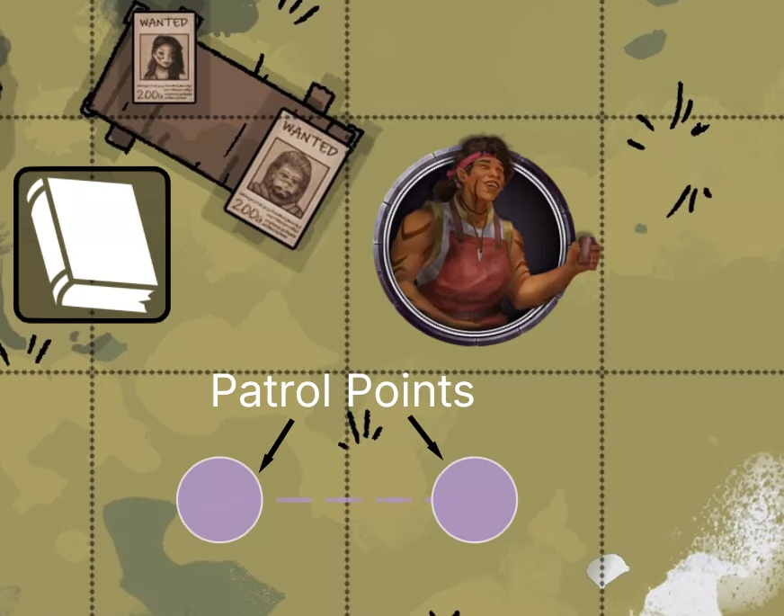
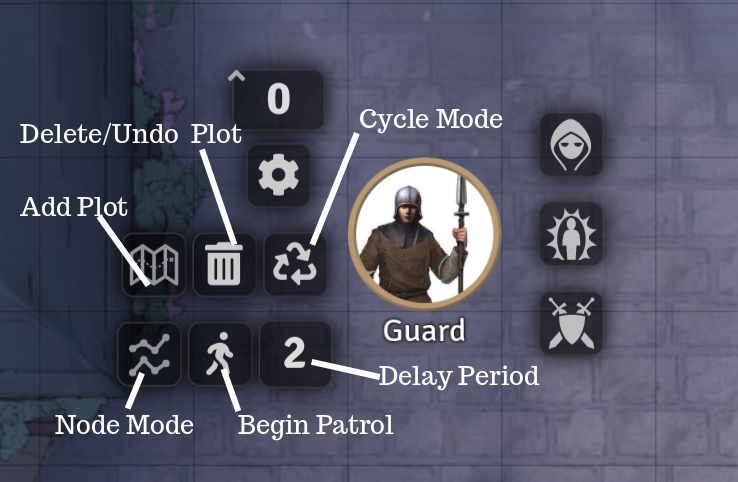

# Foundry Token Patroller

> **Note:** This is a fork of *Token Patroller* (originally by Jacob McAuley), updated for **Foundry VTT V13 and V14**. It is not affiliated with or endorsed by the original author.

Give your tokens the ability to navigate automatically by selecting patrol points. Plot a route for a token, press start, and it walks the route on its own — great for patrolling guards, wandering monsters, market crowds, and more.

## Features

### Patrol points
Add patrol points to visually plot routes (where the token will move)



### Token options
Start movement, add points, etc.



### Emit Audio
Tokens can emit audio. Make your movements more life-like with walking sounds and more.


### Speech
Tokens can speak, and if they see an other token they can mention their name as well.

#### Quotes
With this setting, Patrolling tokens can make mentions towards NPCs and PCs depending on the enabled settings.

This mode requires that Token Vision is enabled, including setting the sight on the token itself, and the corresponding quotes settings enabled. This can be seen more in detail by using the module and reading the hints.

#### Quote Parsing

You can use the keyword {token.name} within your single quotes to substitute the first seen token within. See the image below!

Note: The single quote ---> ' is used as the delimiting factor in seeing quotes. So if you put a quote like 'This isn ' t fair!' an error will be thrown, as the parser would break this into {'This isn', 't fair <--- ERROR NO ENDING}


## Requirements

- Foundry VTT **V13 or later** (verified on V14)
- Square grids are required for *Linear Walk* mode (see below); other grid types work in normal Plot Walk mode

## Installation

**Recommended (auto-updates):** In Foundry, open the launcher's **Add-On Modules** tab → **Install Module** → paste:

```
https://github.com/oniaom/foundry-patrol/raw/master/module.json
```

**Manual:** download [the zip](https://github.com/oniaom/foundry-patrol/archive/master.zip), extract it into your `Data/modules/` folder, and reload Foundry.

Then enable **Foundry Token Patroller** in your world's *Manage Modules* and reload the world.


## Usage: plotting a route

1. **Select a token** (left-click). The token HUD appears with the patrol icons in the left column.
2. Click **Add Point** (map icon). This records the token's **current position** as a patrol point. A colored dot appears on the map at that spot.
3. **Move the token** a few squares and click **Add Point** again. Repeat to build the route.
4. The plotted points are shown as **dots**, connected by an **animated dashed line** in the token's route color. All plotted routes are visible at all times (GM only) — you no longer need to keep the token selected to see them.

### Editing points (GM)

Every plotted point dot is directly clickable on the map — no toolbar tool needed:

- **Left-click a point** — it gets a white ring and a small options popup appears with **Delete point** and **Move point**.
- **Drag a point** on the map to move it — it snaps to the grid (unless the scene is gridless) and the route line follows live; the new position is saved when you release.
- **Right-click a point** to delete it immediately.
- Pressing on a **token** never touches patrol points — you can select or drag a token that sits on top of a point without selecting, moving, or deleting the point.

### Deleting points

- Left-click a point dot and choose **Delete point** in the popup, or right-click the dot.
- Click the **trash icon** in the token HUD to delete **all** points of the token, or just the **last** point (you choose in the dialog).

### Starting / stopping a patrol

- Click the **walking icon** (Start route) to make the token walk its route. The icon switches to a stop icon — click it to halt.
- Or use the **Patrol Tool** in the left sidebar (route icon, GM only): **Start all patrols** (play icon) starts every patrol on the scene and **Stop all patrols** (stop icon) halts them — the same actions as the keybindings below, no keyboard needed. If tokens are selected, only those are affected; otherwise all owned tokens are.
- The **text field** next to it sets the delay (in seconds) between points, e.g. `2` or `1, 4, 2` or `1-5`.
- The **recycle / arrows icon** toggles between *Cycle Mode* (loop the route) and *Forwards-Backwards Mode* (walk the route and then back).
- The **line / linear icon** toggles *Plot Walk* vs *Linear Walk* (square grids only — fills in the grid spaces between points so diagonal movement looks like a straight line).
- The **caret icon** (right column) opens the full **Patrol Menu** with per-token settings: quotes, vision reactions, ambient audio, delay, rotation, language, and more.

### Keybindings (GM, defaults)

Configurable in *Configure Controls* → *Keybindings* under the module:

| Action | Default | Effect |
| --- | --- | --- |
| Start Routes | Ctrl+Shift+G | Start routes for selected tokens (or all owned tokens) |
| Stop Routes | Ctrl+Shift+H | Halt those routes |
| Add Plot Point | Ctrl+Shift+R | Add current position of each selected token as a point |
| Clear Routes | Ctrl+Shift+D | Clear routes of selected (or all owned) tokens |
| Generate Patrol Macro | Ctrl+Shift+M | Create a macro that starts the selected tokens' patrols |

## API

Available on the global `TP` object (GM side), handy for macros:

```js
TP.tokenPatroller.addPlotPoint(tokenId);              // record the token's current position as a point
TP.tokenPatroller.removePlotPoint(tokenId, index);    // delete one plotted point by index
TP.tokenPatroller.movePlotPoint(tokenId, index, { x: 100, y: 200 }); // move one plotted point
TP.tokenPatroller.startPatrol("2", tokenId);          // start patrolling, 2s between points
TP.tokenPatroller.stopPatrol(tokenId);                // stop patrolling
```

## Features beyond routing

- **Quotes** — tokens can speak while patrolling or when spotted (single-quote delimited, `{token.name}` placeholder supported).
- **Vision reactions** — use the token's own vision to detect PCs/NPCs; optionally stop the patrol, pause the game, or start combat when seen.
- **Ambient audio** — attach a sound that follows the patrolling token.
- **Token rotation** — tokens face the direction they are walking.

All of these are configured per token in the Patrol Menu (caret icon in the token HUD).

## Known quirks (Exist in original mod but not checked against latest foundry version)

- Deleting several tokens at once while they are patrolling can occasionally throw an error — refresh (F5) to recover.
- Running multiple GM/assistant users at once can behave unexpectedly.

## Attributions

- Fork of *Token Patroller* by Jacob McAuley.
- Linear Walk icon: https://www.iconfinder.com/icons/214663/arrow_points_icon
- Normal Walk icon: https://www.iconfinder.com/icons/2639849/chart_line_icon
